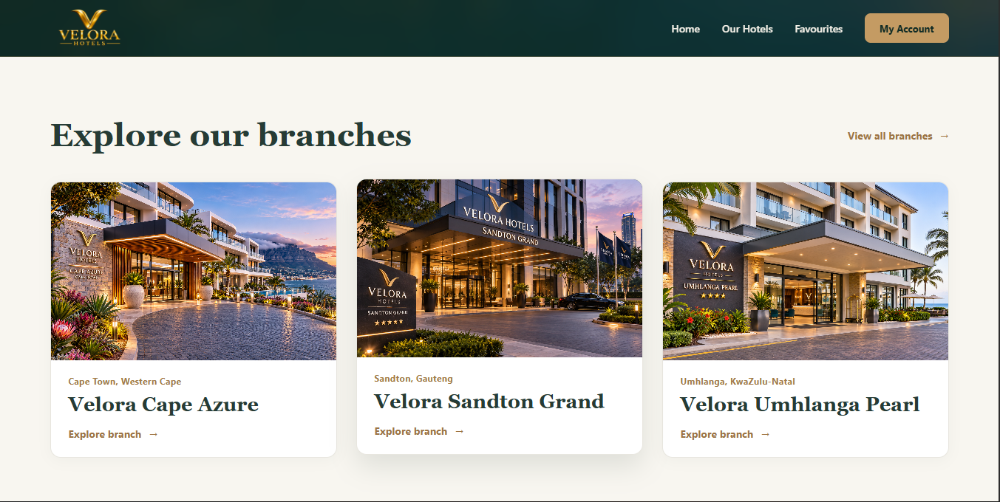
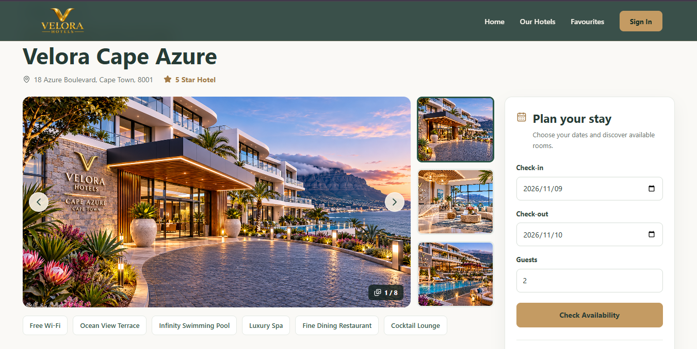
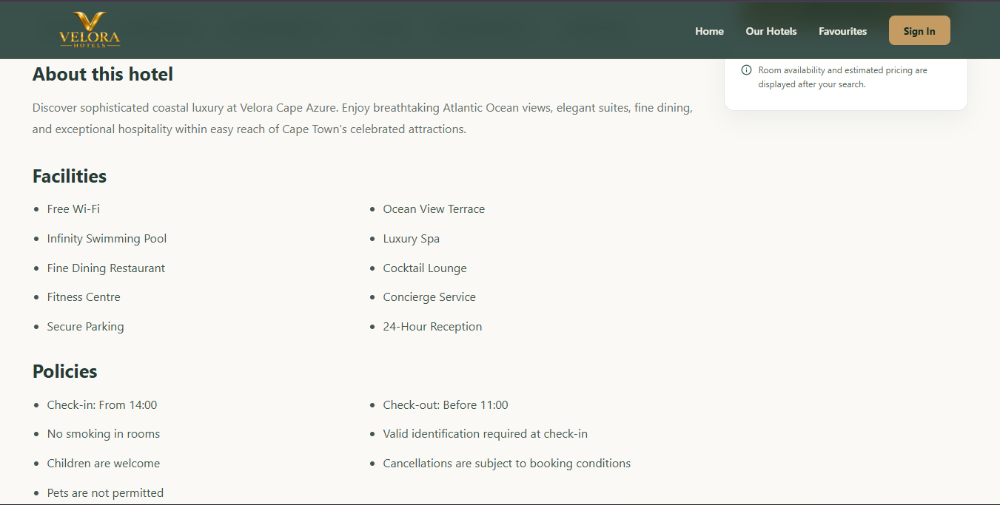
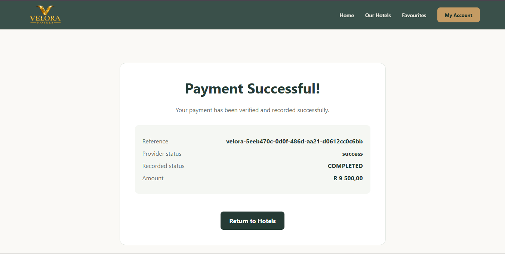
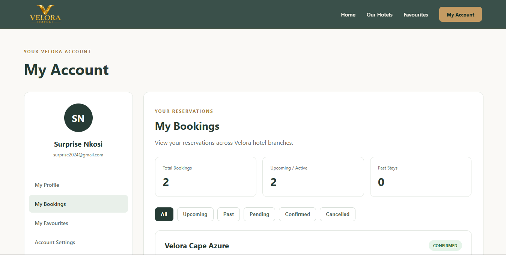
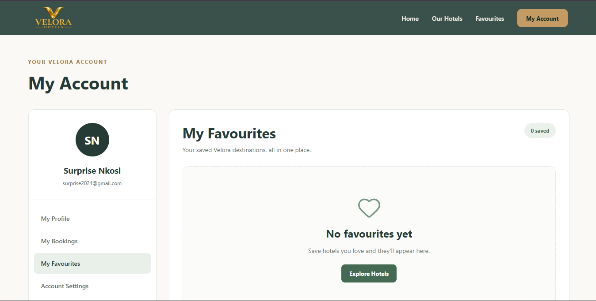
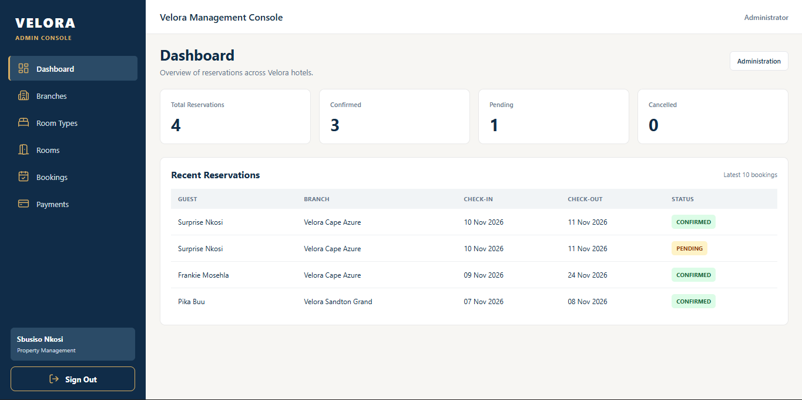

<div align="center">

# 🏨 VELORA HOTELS

### Discover Your Stay. Book with Confidence.

**A Modern Hotel Booking & Management Platform**

Explore beautiful destinations, discover accommodation,
reserve rooms, and manage your hotel stays through one connected experience.

<br />


**[About](#about-velora) • [Features](#features) • [Gallery](#application-gallery) • [Technology](#technology-stack) • [Installation](#getting-started) • [Roadmap](#development-roadmap)**

</div>

---

## ✨ About Velora

**Velora Hotels** is a full-stack hotel booking and management web application designed to make discovering, reserving, and managing accommodation easier.

Velora represents a single hotel brand operating across multiple locations.

The platform connects customers and hotel administrators through one integrated system.

### For Customers

Customers can:

- Explore Velora hotel branches.
- Search for accommodation.
- View hotel and room information.
- Check room availability.
- Select booking dates and guest numbers.
- Create hotel reservations.
- Complete online payments.
- Sign in using Google.
- Book accommodation as guests.
- View booking history.
- Save favourite hotels.

### For Administrators

Administrators can manage:

- Hotel branches.
- Room types and inventory.
- Room capacity and pricing.
- Hotel reservations.
- Payment information.
- Protected administrative operations.

> **Project Status:** Velora is under active development. Core booking, authentication, payment, hotel discovery, and administration functionality has been implemented. Additional features and final production testing are still in progress.

---

## 📸 Application Gallery

Explore the Velora Hotels experience.

### 🏠 Homepage

The starting point of the Velora experience, featuring hotel discovery and search.


### 🏨 Our Hotels

Browse Velora hotel branches and explore accommodation options.



### 🛏️ Hotel Details

Explore hotel information, accommodation options, and available facilities.




### 📅 Hotel Reservations

Select your travel dates, guests, and preferred accommodation.


### 💳 Secure Checkout

Complete the reservation process using the integrated Paystack payment flow.



### 📋 My Bookings

View reservations associated with your customer account.



### ❤️ Favourite Hotels

Save preferred hotel branches for easier access.



### 🛡️ Administration Dashboard

Manage hotel operations through the protected administration interface.



---

## 🚀 Features

### 1. Google Authentication

Velora supports Google OAuth authentication.

Customers can sign in using their Google accounts instead of creating separate passwords.

The backend manages authentication sessions and links customer accounts to their stored information.

### 2. Hotel Discovery and Search

Customers can browse Velora hotel branches and search for accommodation by hotel name, branch, or city.

Redux Toolkit manages the search state, including:

- Current search input.
- Submitted search query.
- Clearing the search.

### 3. Hotel and Room Details

Customers can explore hotel branches and review accommodation information before making a booking.

The platform stores hotel and room information in PostgreSQL.

### 4. Room Availability

Velora checks room availability using:

- Check-in date.
- Check-out date.
- Number of guests.
- Room capacity.
- Existing reservations.
- Available room inventory.

Availability checks help prevent overlapping reservations.

### 5. Hotel Booking

Customers can create reservations by selecting accommodation and providing the required booking information.

The backend validates booking requests and manages reservation records.

### 6. Guest Checkout

Customers can book accommodation without first creating a registered account.

This makes the booking process more convenient for visitors.

### 7. Paystack Payments

Velora integrates Paystack for online payments.

The backend verifies payment results and maintains payment records.

The current integration has been tested using Paystack's test environment.

### 8. Booking History

Authenticated customers can access reservations associated with their accounts.

### 9. Favourite Hotels

Customers can save preferred hotel branches for future reference.

### 10. Booking Reliability

Velora includes protections against accidental duplicate booking requests.

The system uses booking idempotency information to identify repeated checkout requests.

### 11. Hotel Administration

Authorized administrators can manage hotel branches, accommodation inventory, bookings, and payment information.

Administrative routes are protected by account permissions.

---

## 🔄 How Velora Works

The customer booking journey follows this process:

```text
VISIT VELORA
     |
     v
EXPLORE HOTELS
     |
     v
SEARCH FOR ACCOMMODATION
     |
     v
VIEW HOTEL DETAILS
     |
     v
SELECT DATES AND GUESTS
     |
     v
CHECK ROOM AVAILABILITY
     |
     v
SELECT ACCOMMODATION
     |
     v
CREATE RESERVATION
     |
     v
PAYSTACK CHECKOUT
     |
     v
VERIFY PAYMENT
     |
     v
UPDATE BOOKING STATUS
     |
     v
VIEW BOOKING DETAILS
```

The backend handles important operations such as validation, availability checking, booking management, and payment verification.

---

## 🛠️ Technology Stack

### Frontend

| Technology | Purpose |
|---|---|
| React | Interactive user interface |
| TypeScript | Type-safe application development |
| Vite | Development server and production builds |
| React Router | Page navigation |
| Redux Toolkit | Shared application state |
| React Redux | React and Redux integration |
| CSS | Styling and responsive layouts |
| Lucide React | Interface icons |

### Backend

| Technology | Purpose |
|---|---|
| Node.js | Backend runtime |
| Express | API development |
| TypeScript | Type-safe backend development |
| Prisma ORM | Database access |
| Zod | Request validation |
| Helmet | HTTP security settings |
| CORS | Cross-origin request configuration |
| Express Rate Limit | Request rate limiting |

### Database

| Technology | Purpose |
|---|---|
| PostgreSQL | Relational data storage |
| Prisma Migrate | Database schema migrations |
| Neon | Hosted PostgreSQL database |

### Authentication and Payments

| Technology | Purpose |
|---|---|
| Google OAuth | Customer authentication |
| Backend Sessions | Authenticated session management |
| Paystack | Payment processing and verification |

### Deployment and Development

| Technology | Purpose |
|---|---|
| Vercel | Frontend hosting |
| Render | Backend hosting |
| Neon | Database hosting |
| Git | Version control |
| GitHub | Source code hosting |
| Figma | UI/UX design |
| Visual Studio Code | Development environment |

---

## 📁 Project Structure

```text
velora/
     backend/
          prisma/
               migrations/
          scripts/
          src/
               config/
               generated/
               lib/
               middleware/
               routes/
               service/
               types/
               app.ts
               server.ts
          tests/
          .env.example
          .gitignore
          package-lock.json
          package.json
          prisma.config.ts
          prisma.config.ts
          tsconfig.json
     docs/ 
     frontend/
          public/
          src/
               assets/
               components/
               context/
               hooks/
               lib/
               pages/
                    admin/
               schemas/
               store/
               App.css
               App.tsx
               index.css
               main.tsx
          .gitignore
          eslint.config.js
          index.html
          package-lock.json
          package.json
          tsconfig.app.json
          tsconfig.json
          tsconfig.node.json
          vercel.json
          vite.config.ts
     .gitignore
     package-lock.json
     README.md
```
> This is a simplified representation of the project structure.

---

## 💻 Getting Started

### Prerequisites

Install the following:

- Node.js
- npm
- PostgreSQL
- Git
- A code editor such as VS Code

Google OAuth and Paystack test credentials are needed to test those integrations.

### Step 1: Clone the Repository

```bash
git clone https://github.com/surprise2024-cpu/velora.git

cd velora
```

### Step 2: Install Backend Dependencies

```bash
cd backend

npm install
```

### Step 3: Configure Environment Variables

Create a `.env` file inside the `backend` directory.

Configure the required environment variables for:

- PostgreSQL.
- Google OAuth.
- Application sessions.
- Paystack.
- Frontend and backend URLs.

Prisma uses:

```env
DATABASE_URL="your_postgresql_connection_string"
```

Refer to the backend configuration for the exact names of all other required variables.

### Step 4: Configure PostgreSQL

Ensure PostgreSQL is running.

Check the database migration status:

```bash
npx prisma migrate status
```

Apply migrations to a local development database when necessary:

```bash
npx prisma migrate dev
```

Generate the Prisma Client:

```bash
npx prisma generate
```

### Step 5: Start the Backend

```bash
npm run build

npm start
```

### Step 6: Install Frontend Dependencies

Open another terminal.

```bash
cd frontend

npm install
```

### Step 7: Start the Frontend

```bash
npm run dev
```

Open the local URL displayed by Vite.

Make sure the frontend API configuration points to the running backend.

---

## 🧪 Development and Testing

### Frontend

Run the development server:

```bash
npm run dev
```

Check code quality:

```bash
npm run lint
```

Build for production:

```bash
npm run build
```

### Backend

Check TypeScript:

```bash
npm run typecheck
```

Build the backend:

```bash
npm run build
```

Start the backend:

```bash
npm start
```

### Database

Check migration status:

```bash
npx prisma migrate status
```

Generate Prisma Client:

```bash
npx prisma generate
```

```bash
npx prisma migrate deploy
```

> Always confirm the target database before deploying migrations.

---

## ☁️ Deployment

Velora uses the following deployment services:

| Platform | Responsibility |
|---|---|
| Vercel | React frontend |
| Render | Express backend |
| Neon | PostgreSQL database |

---

## 🔐 Security

Velora includes security and reliability measures such as:

- Google OAuth authentication.
- Backend session management.
- Protected administrative routes.
- Account role checks.
- Input validation.
- HTTP security headers.
- CORS configuration.
- Request rate limiting.
- Booking conflict checks.
- Duplicate booking request protection.
- Backend payment verification.
- Environment-based secret management.

---

## 🔗 Repository

**GitHub:** https://github.com/surprise2024-cpu/velora

This repository contains the frontend, backend, database schema, migrations, and supporting project documentation.

---
<div align="center">
     
# VELORA HOTELS

### Discover Your Stay. Book with Confidence.

**Thoughtfully Designed. Carefully Engineered.**

Built with React, TypeScript, Node.js, Express, PostgreSQL, and modern web technologies.

</div>
